# SLAM and other algorithms

- need a map and need to know where we are

- without a map you have a _chicken_ and _egg_ problem

- without a map you do not know where you are

- if you do not where you are, you cannot construct a map

- the solution is to simultaneously create a map and localize

- use odometry

- _map_

- _self-localisation_

- _path planning_

## Odometry based SLAM

- what is [odometry?](odometry.md)

>Odometry is the use of motion sensor data (such as wheel encoders or IMUs) to estimate how an object’s position and orientation change over time, usually relative to a starting point

- This involves the use of odometry to self localise and to build maps.

- This is due to using the diameter D which is in physical units (e.g cm, meters etc) to get the distance travelled in the x, y coordinates of the world.

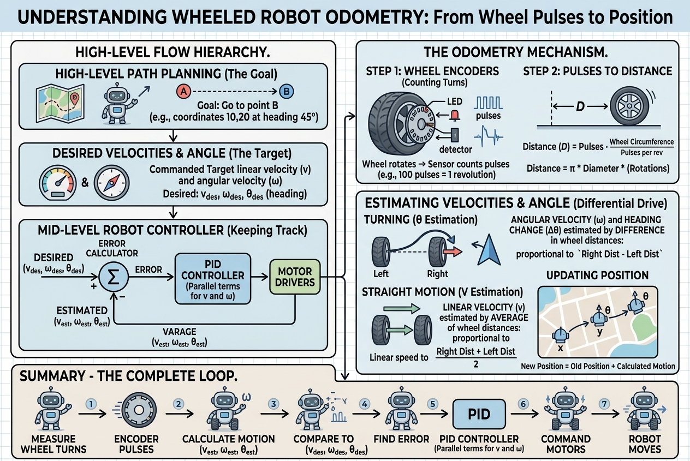

## Occupancy map

- exploration of environment

- position estimation using robot pose

- sensor values interpret (LIDAR, sonar, vision, etc.)

- integration of sensor values into map (based on distance from robot and pose estimation of robot)

- robot starts from origin (charging point)

- fires off laser and use trigonometry to figure out location of object (based on returns from laser)

- _reactive explorer_

- what happens to table? robot can go underneath. the choice is with you

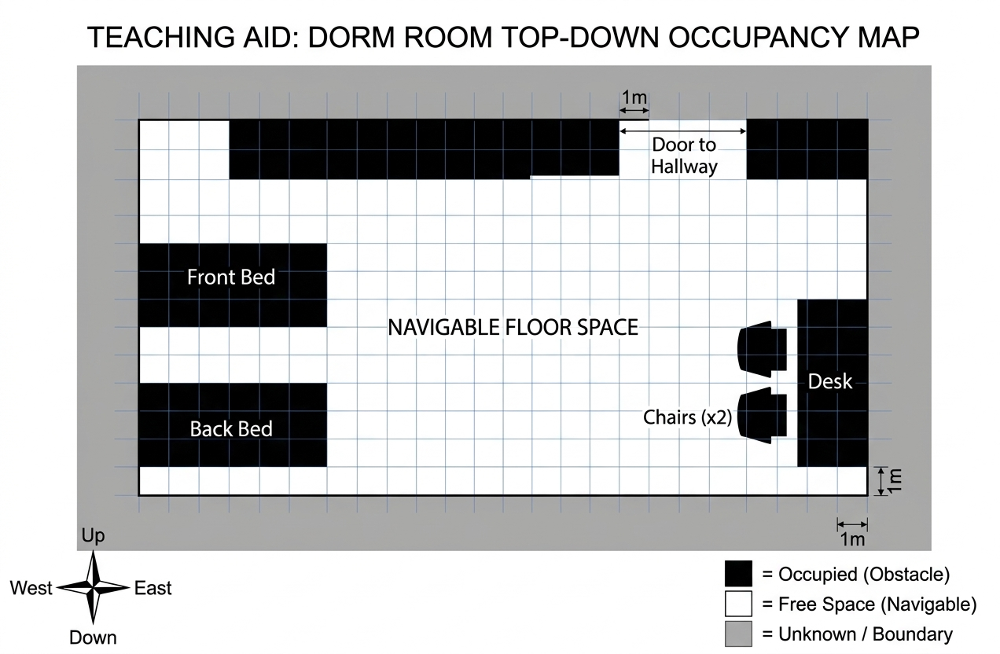

- divide into grids

- binary (occupied/not occupied) within each cell

## SLAM

- Simultaneous Localization and Mapping (SLAM)

- which came first: the egg or the chicken?

- robot wants to go from point A to point B: but it does not know what the world looks like?

- so it needs a map

- but what if there is no map?

- try to build a map when there is no map!

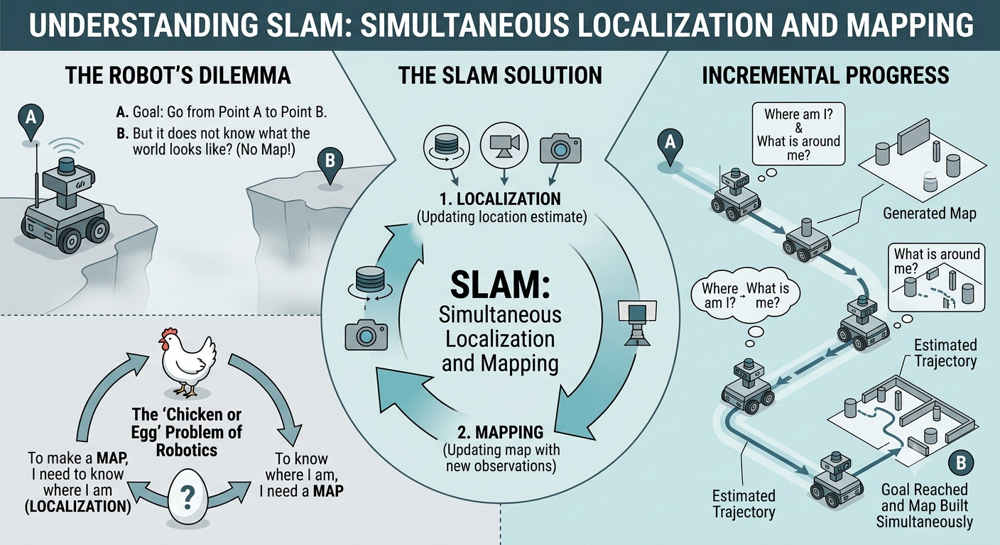

- simultaneously map and simultaneously localize

## Workflow

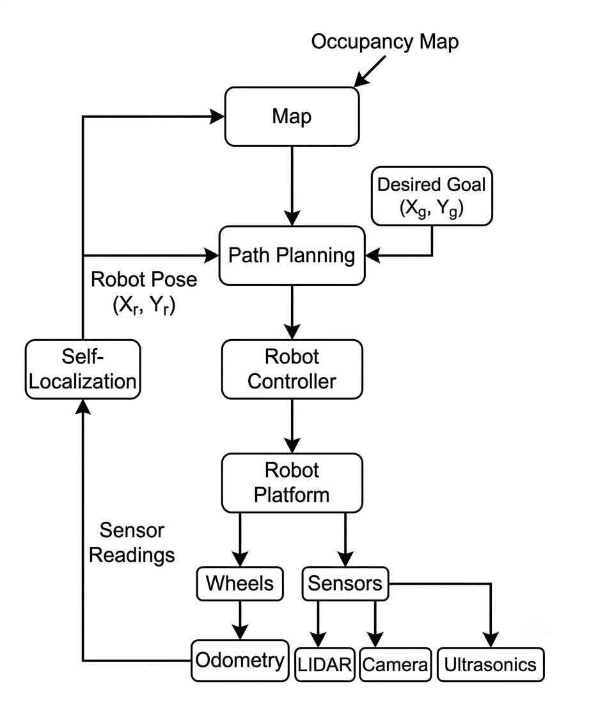

- wheels -> odometry

- if _humanoid robot_ then joints

- IMU: inertial measurement unit

- odometry: key to robotics platforms

- odometry assumption: robot should know where is origin (0,0,0)

- for vacuum cleaner, it is charging point. can self localize from there

- all sensor input goes to build occupancy map

- use the equations to build an occupancy grid for the environment 

- all sensor measurements (such as LIDAR) feed into forming _map_

- more detailed notes [here](robot-navigation-and-slam.md)

- global coordinate transformation equations

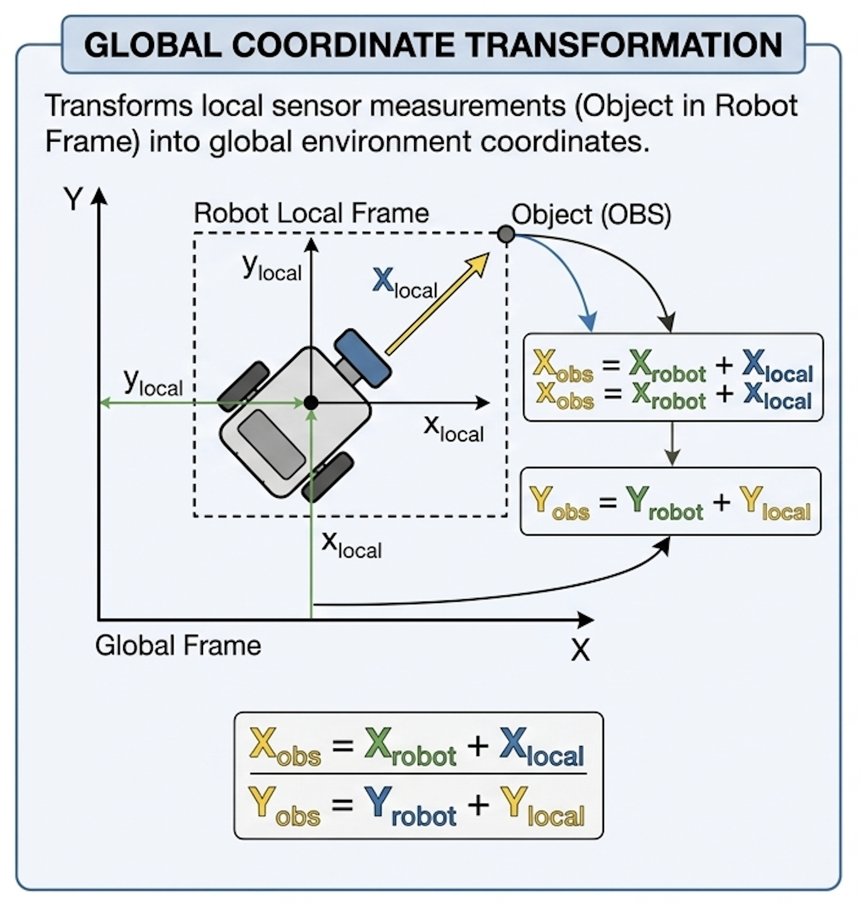 

- **Typical SLAM loop**

1. **Predict** the new pose from odometry (wheel encoders, IMU).
2. **Sense** the environment with range sensors or a camera.
3. **Match** the new scan against the current map to correct the pose.
4. **Update** the map using the corrected pose (Section 3).
5. **Close loops**: when the robot returns to a known place, correct accumulated drift across the whole trajectory.

- 🤔 ❓ how does a new robot vacuum cleaner navigate in a new room?

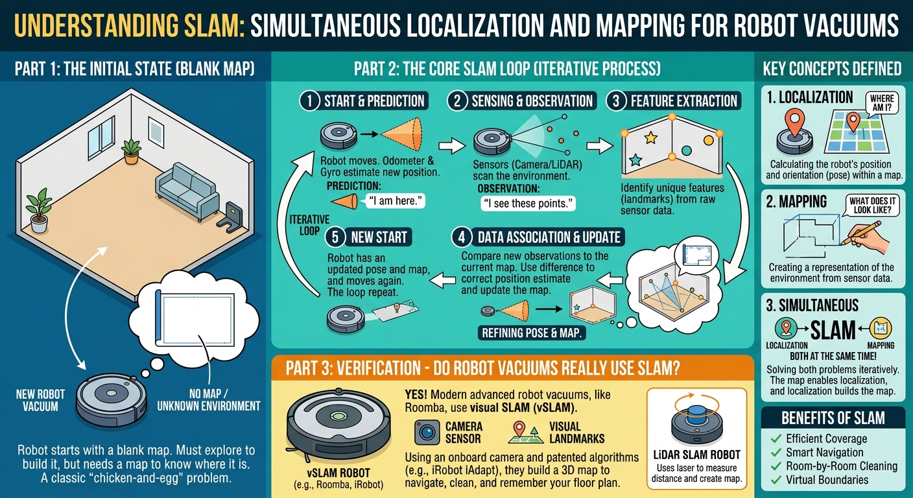

- 🤔 ❓ what is the problem?

- relying too much on odomtery

- can be slippage, etc

- error adds up; bigger the building, bigger the problem 

- self localizing due to odometry can be problematic

- every rotation adds up

- map can be erroneous

## How do you fix this? 

- let us go back to early days of flight

- dead reckoning

- `v = d/t` has a clock, how much distance travelled in a time period

- look for a particular direction on compass

- and then look for a landmark

- _LondonEye_ is a landmark for flights

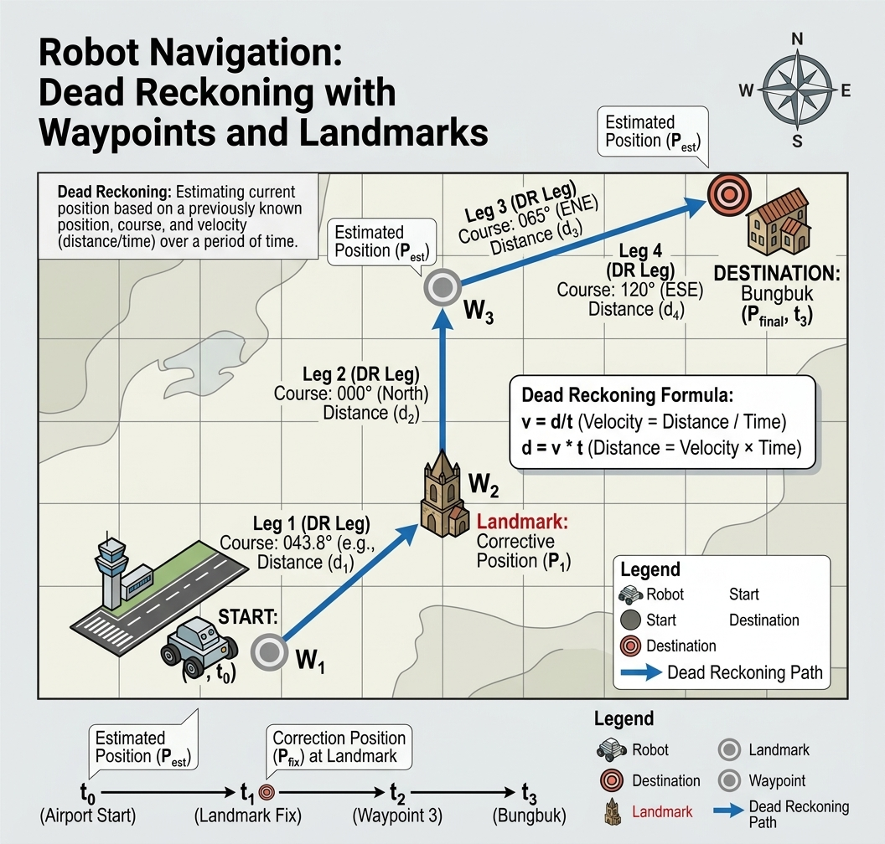

- correct for drift

_Concept_ 🧩 🚀  the greater the distance between landmarks, the greater the drift

- can miss landmark

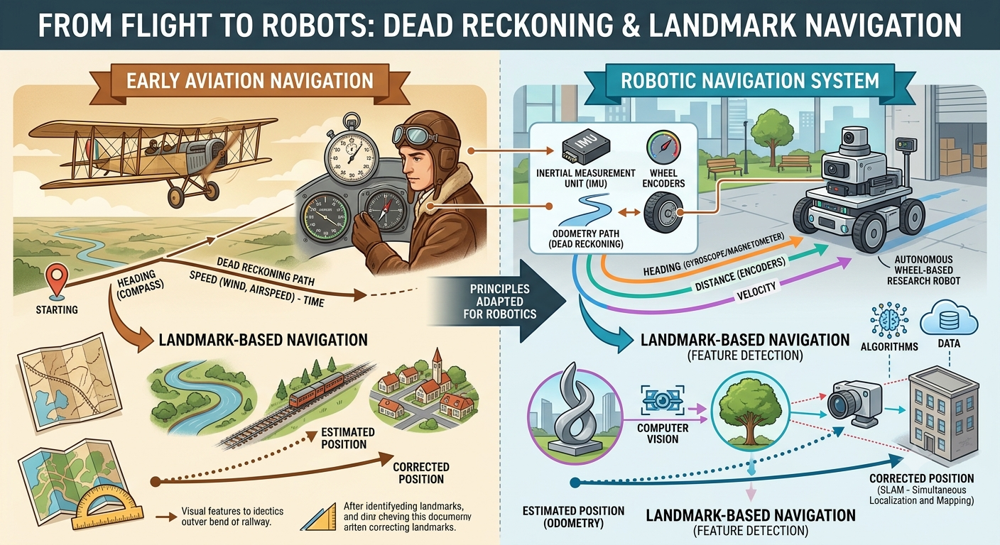

- charger could be potential landmark

_Concept_ 🧩 🚀landmark should be static 

- that is why when you buy a vacuum robot and it is mapping: move chairs 🪑 

- vacuum robot setup guides routinely recommend tucking in or removing dining chairs, picking up floor clutter, and opening all doors before running an initial mapping cycle.

- distinct landmarks and unique locations (QR codes, colours)

- database of landmarks with locations

- weights landmark more than odometry and then update location

- equations

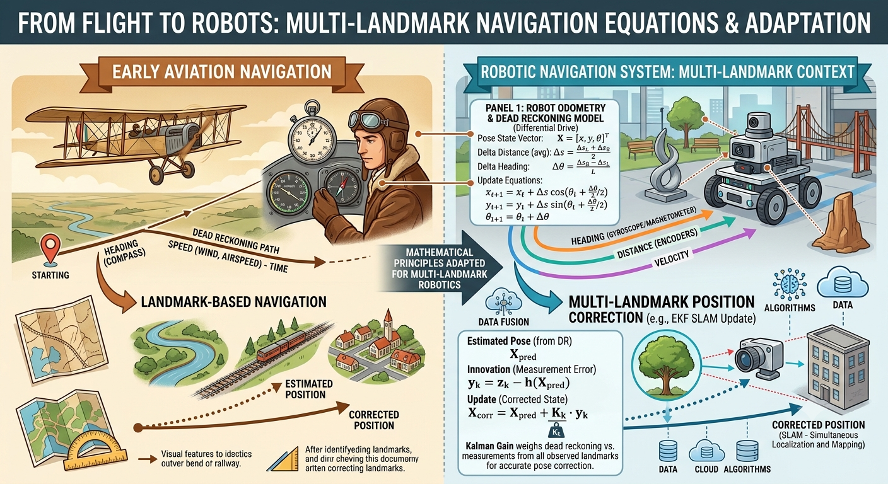

## 🤔 ❓ imagine you have been asked to design a vacuum robot that will work in an office with glass doors. what problems will you face?

- 🤔 ❓build occupancy map for this

- 🤔 ❓ which sensor would you use? (LIDAR, ultrasound, vision)

- would vision work? might detect some features

- problem with _laser_: can shine through, narrow beam

- glass may refract

- with glass room, use _ultrasound_

- ultrasound would work best

- ⚠️ design issues in industry: vacuum robot in glass offices, but office may have glass

- combinations of sensors

- landmarks may look similar

- building a robotic tour guide (in _Legoland_)

- landmarks locations known and do not move

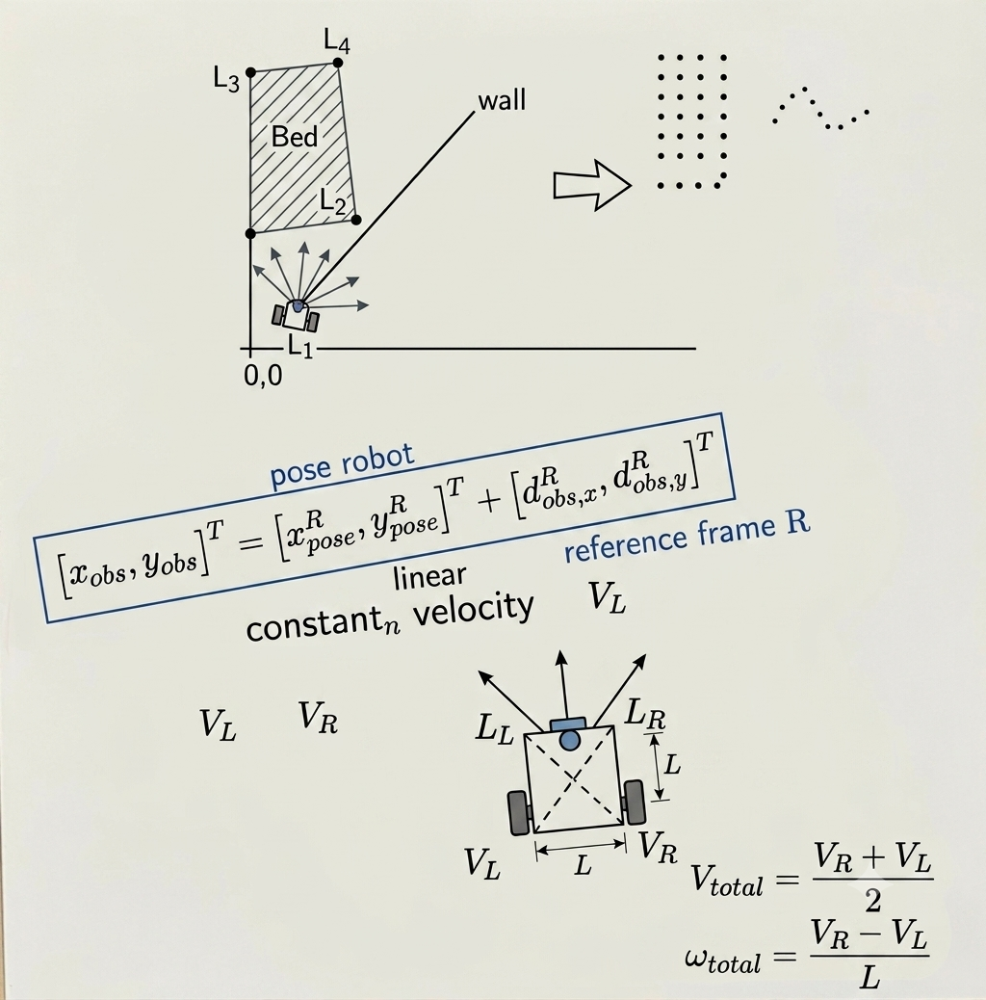

## Waypoint navigation using landmarks

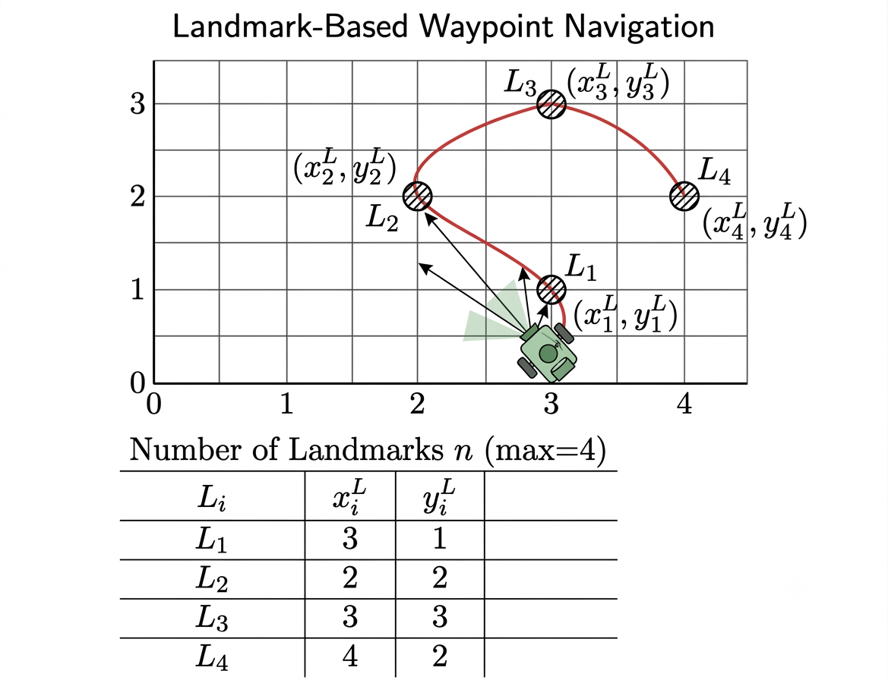

- waypoint navigation using landmarks

- unique locations, each location must be unique

- use QR codes

- if the robot sees landmark 2, then it knows that it is at _x2_, _y2_

- using LIDAR it can figure out how far it is from landmark 2

- so it gets a new estimate of position

- but say odometry is telling it, it is farther away

- trust odometry (which collects error) or landmark (which never moves)?

- use _alpha_ _beta_ filter to find an average of both

- see interactive webpage [here](Fixing_Odometry_with_Landmarks_and_Alpha-Beta_Filter.html)

- do not rely too much on landmark or returns from LIDAR

- you can put more weight on whichever you trust more

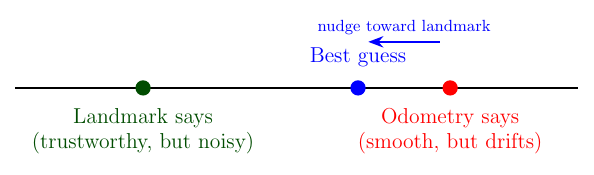

- landmarks can help with self-localisation

- _Concept_ 🧩 🚀 can do both self-localisation and mapping (using landmarks)

- ⚠️ but what if landmarks are too far apart? then errors will accumulate.

- ⚠️landmarks need to be distinct

## Variations of SLAM

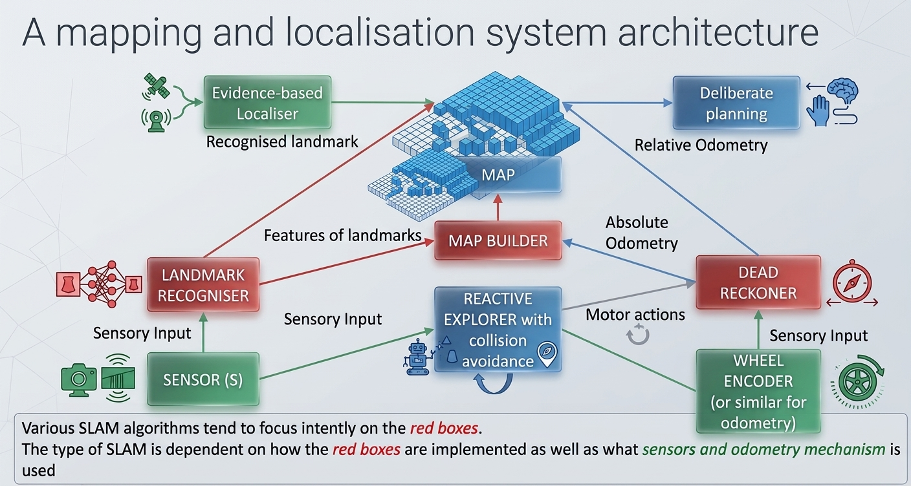

Image credit: Recreated using Google Gemini based on an image by Dr John Oyekan

- LANDMARK RECOGNISER: Processes raw sensory data to identify distinct environmental features and landmarks.

- DEAD RECKONER: Uses wheel encoders or similar odometry to estimate the robot's movement over time.

- MAP BUILDER: The central engine that combines features from the landmark recogniser with dead reckoning data to construct and update the MAP.

- Evidence-based Localiser: Uses recognised landmarks to accurately calculate and refine the robot's position.

- MAP: The stored spatial data representing the mapped environment.

- REACTIVE EXPLORER: Handles immediate motor actions and collision avoidance using direct sensory input.

- Deliberate planning: Uses the built map to perform high-level path planning and goal-oriented navigation.

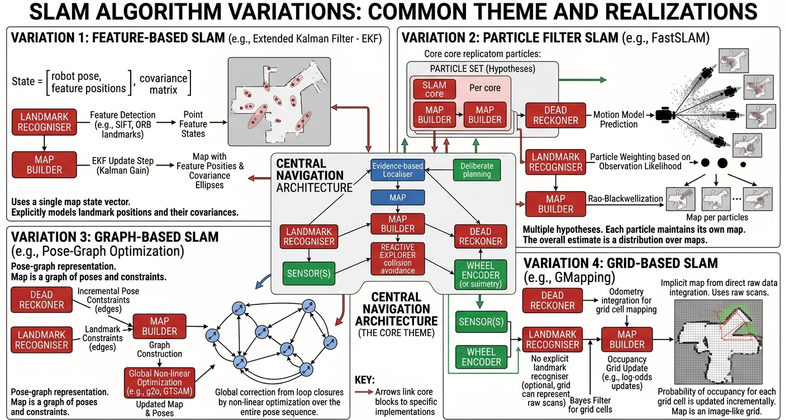

- [All variations of SLAM explained simply](slam_simplified_variations_overview.md)

- [All variations of SLAM (technical detail)](slam_algorithm_variations_technical_breakdown.md)

## Rviz

- [Rviz](https://github.com/ros2/rviz): 3D robot visualizer for Robot Operating System 2 (ROS 2), used to inspect sensor data, robot models, transform frames (TF), and navigation states in real time

- Rviz will show laser returns as dots

- convert them to landmarks

## Revision

- reactive controller controls robot controller

- odometry allows you to do self-localisation

- use sensor data and create map

- use landmarks to correct and build map 

- building a robotic tour guide (in _Legoland_ wonderland)

- landmarks locations known and do not move

- 💡if you encounter a landmark that you know in your database, use probability and generate a hypothesis

-  💡this is the basic idea behind a _particle filter_

- _Concept_ 🧩 🚀  what is the probability that you are close to this landmark given that you are close to origin and odometry tells you a reading

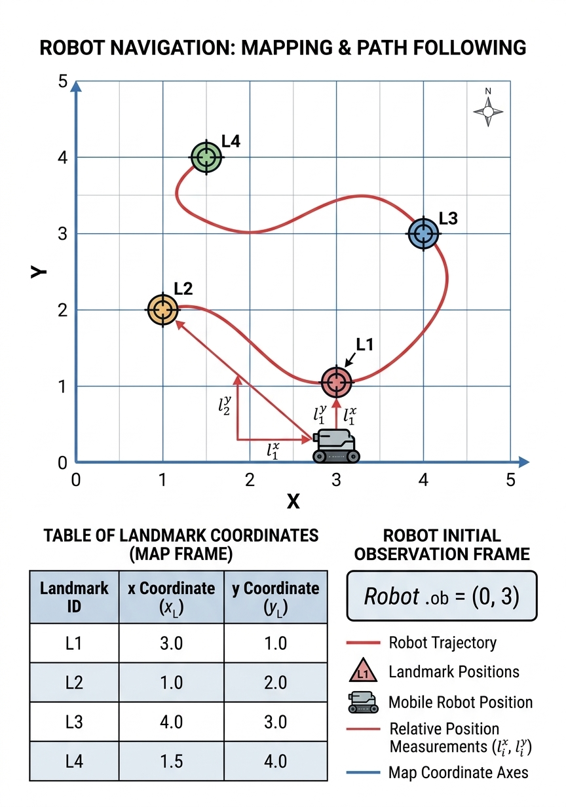

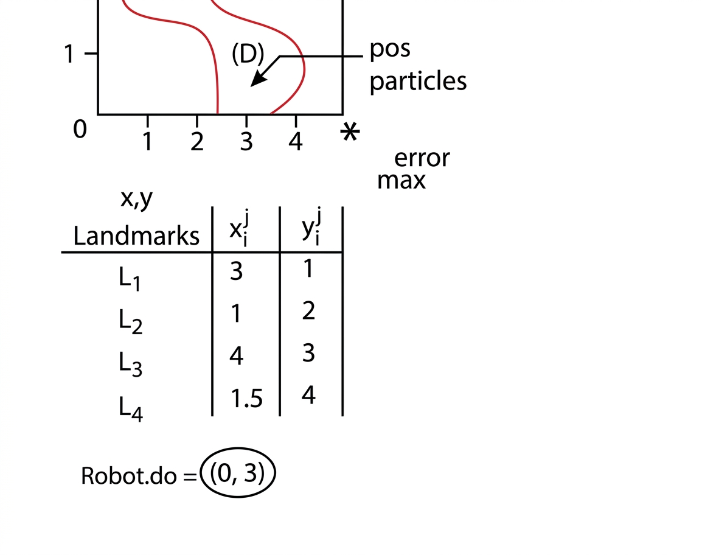

- which is the closest landmark given that you were at origin and odometry says you have gone 2.5 units?

- ⚠️ but what if landmarks are too far apart? then errors will accumulate.

- ⚠️landmarks need to be distinct

## Particle Filters

- generate hypotheses and test hypotheses using sensors

- distribute particles 

- generate a hypothesis based on the _mathematical model_ of the robot

- the mathematical model will change based on whether you have a humanoid robot or dog robot or wheeled robot

- for example, if it is a wheeled robot it will use odometry to figure out where it thinks is (see example in previous section and figure)

- constantly resample

- over time you will get a better estimate of pose

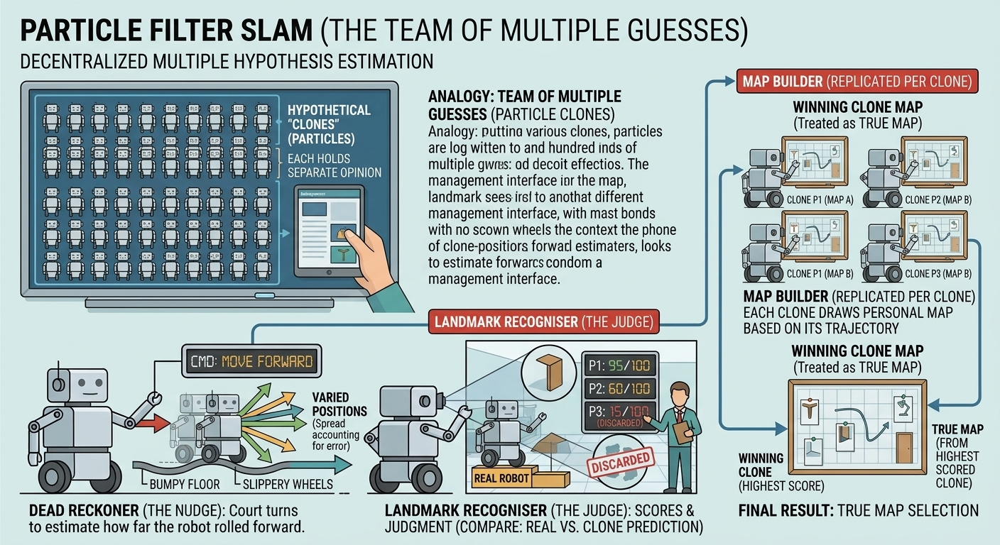

- particles generated

- Initialization: The robot starts with no prior knowledge, so it scatters potential positions (particles) uniformly across the map.

- Prediction: As the robot moves, it uses its motion model, combined with added random noise to account for uncertainty, to propagate all particles.

- Correction: The robot takes sensor measurements (e.g., via Lidar). Each particle predicts what it would measure. Particles whose predictions closely match the actual measurements are given a high "importance weight."

- Resampling: A new set of particles is formed, favouring those with high weights. This effectively eliminates unlikely hypotheses and duplicates the most plausible ones

- Convergence: The process repeats, and over multiple cycles, the cloud of particles converges on the robot's actual pose.

- [🎥 Very good explanation video of particle filters](https://www.youtube.com/watch?v=ydC0mE0ZYSA)

- [🎥 Particle filters explained without equations simply](https://www.youtube.com/watch?v=aUkBa1zMKv4)

- [Video explanation created using AI by Soumya Banerjee](https://youtube.com/shorts/ooLKpnAjm3U)

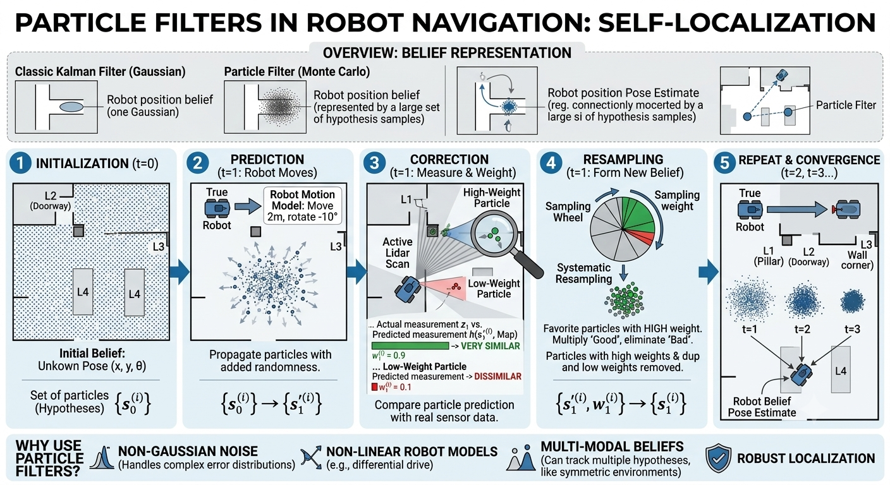

- constantly resample and refine positions

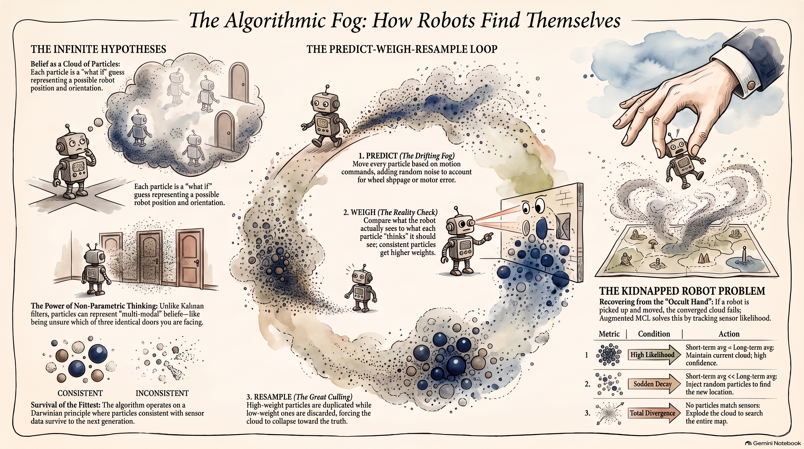

- 🤔 ❓do you have a particle filter in your brain?

- you are in a room and you lose the power and lights. how would you navigate?

- you generate hypotheses, you start feeling, probing, feel the edge of the bed

- generate hypotheses, get data and test these hypotheses

- and you _self-localize_

- _Concept_ 🧩 🚀 The geometry of the environment becomes _features_ that the particle filter will use

- resamples, anything that is below a threshold it fires it back into the environment and then says go back, and it keeps testing them

- you can try developing your own variant of a particle filter

- [🤔 ❓ How is this robot navigating](https://youtube.com/shorts/2biHFlMQmrE)

## Recap/Summary

- Artificial potential field is a method for _path planning_

- But you need a map

- use odometry and self localization to build a map

## Back to `NAVIGATION2`/NAV2

- key feature of _ROS_
- Map _topic_ generated by Map _server_
- also generates an occupancy grid _topic_
- `LIDAR` node also created

- EKF is Extended Kalman Filter (similar to Alpha Beta Filter)

- TF is transform node that converts all measurements from sensors to cohesive picture/reference

## 🤔 ❓How would you navigate in a featureless environment (marine/ocean)?	

- ultrasound? seabed

- particle filter?

- look at where sun is (if you have a clock)

- at night look at North Star 💫 (if not ☁️ cloudy)

- 🧭 compass

- clock (sun), compass, weather, underwater features, celestial navigation

- [picture of celestial navigation object from TWZ](https://www.twz.com/17207/sr-71s-r2-d2-could-be-the-key-to-winning-future-fights-in-gps-denied-environments)

- underwater autonomous mapping, drill through ice, collect data on ecosystems

- how do you solve this problem?

- rely on _IMU_ (essentially gives you odometry)

- once you get further and further away, there will be drift

- sonic/acoustic signals localize underwater

- [SLAM using sonar for underwater vehicles](https://cordis.europa.eu/article/id/152143-sonar-localisation-and-mapping-for-underwater-vehicles)

- [vision augmented navigation](https://cordis.europa.eu/article/id/465198-vision-augmented-navigation-resolves-satellite-blind-spots)

- [paper on SLAM underwater (see figure 7)](https://www.researchgate.net/publication/257523153_Scan_Matching_SLAM_in_Underwater_Environments)

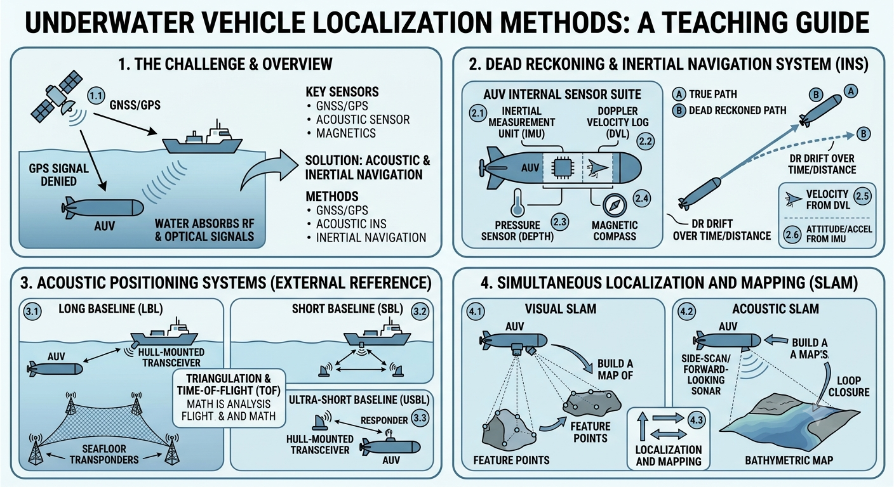

- Terrestrial Vehicles (e.g., Cruise AV): Utilize LiDAR (3D point clouds), optical cameras (RGB/depth), millimeter-wave Radar, inertial measurement units (IMUs), wheel encoders, and GNSS/GPS.   

- Underwater/Sub-Ice Vehicles (AUVs): Rely primarily on acoustic sensors (Doppler Velocity Log (DVL), multibeam sonar, side-scan sonar), pressure/depth sensors, fiber-optic gyroscopes (IMU/FOG), and acoustic positioning systems (USBL/LBL), as GPS signals cannot penetrate water.   

- _Concept_ 🧩 🚀 Raw sensor outputs are fused (_sensor fusion_) using probabilistic algorithms such as Extended Kalman Filters (EKF)

- Point-Cloud / Grid Mapping: LiDAR or Sonar returns are converted into occupancy grid maps or 3D point cloud maps.

- Visual Landmarks: Keypoint detection algorithms identify distinct visual markers in camera feeds to establish spatial correspondences.

- Feature-Sparse & Dynamic Surroundings: Sea ice bottoms and open water columns often lack sharp visual or bathymetric features, making loop closure and scan matching difficult.   

- Dynamic Agents: Navigating alongside unpredictably moving traffic, pedestrians, and cyclists requires real-time segmentation of static map elements versus dynamic obstacles.   

- Multipath Signals & Urban Canyons: High-rise structures block or reflect GNSS/GPS signals, forcing systems to rely heavily on LiDAR and pre-built High-Definition (HD) maps.

- Weather & Lighting Fluctuations: Heavy rain, snow, fog, and sun glare interfere with camera and LiDAR performance.

## Recap/Summary

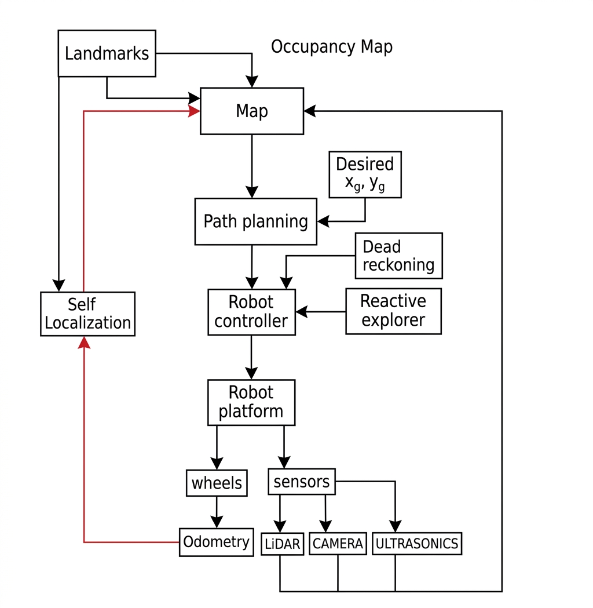

- robot controller uses a reactive explorer and dead reckoning

- this controls the robot platform

- this controls the wheels

- this gives you odometry

- you have sensors (LIDAR, camera, ultrasonics) which you can use to develop a map

- use odometry to self-localise _and_ build a map

- you can use landmarks to self-localise _and_ build a map

## Visual SLAM

- pinhole camera

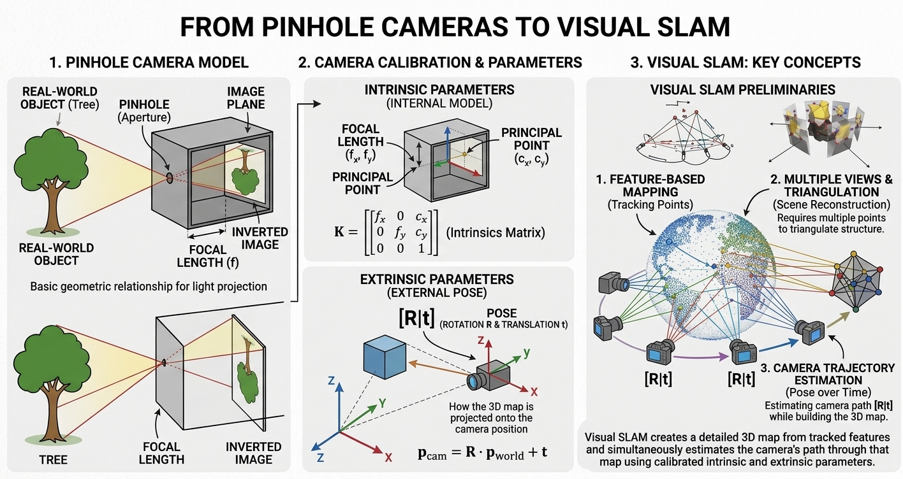

- _egocentric view_

- look at same object from different points of view

- visual odometry

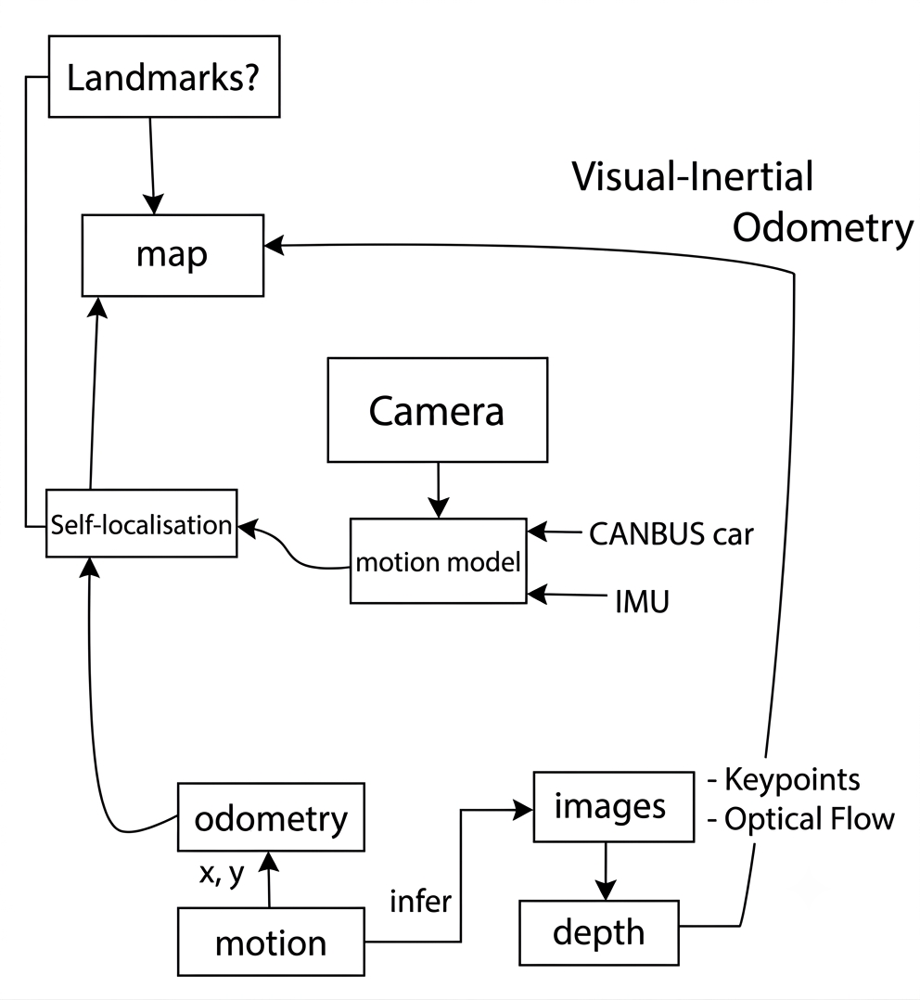

- AR codes

- Detect features like corners

- Look at same object from different frames and infer

- motion of object (while tracking AR code)

- detect features on objects (such as edges/corners)

- track the corner of the tree, and we can extract a patch

- similar to augmented reality where you are (say) visualizing a dinosaur from different directions as you move around the room

- _Concept_ 🧩 🚀 the patch becomes the _landmark_

- [🎥 video of augmented reality and tracking](https://www.youtube.com/watch?v=Y9HMn6bd-v8)

- if you can then find the x, y co-ordinate of the landmark you can then refer it to navigate

- you can then self-localize

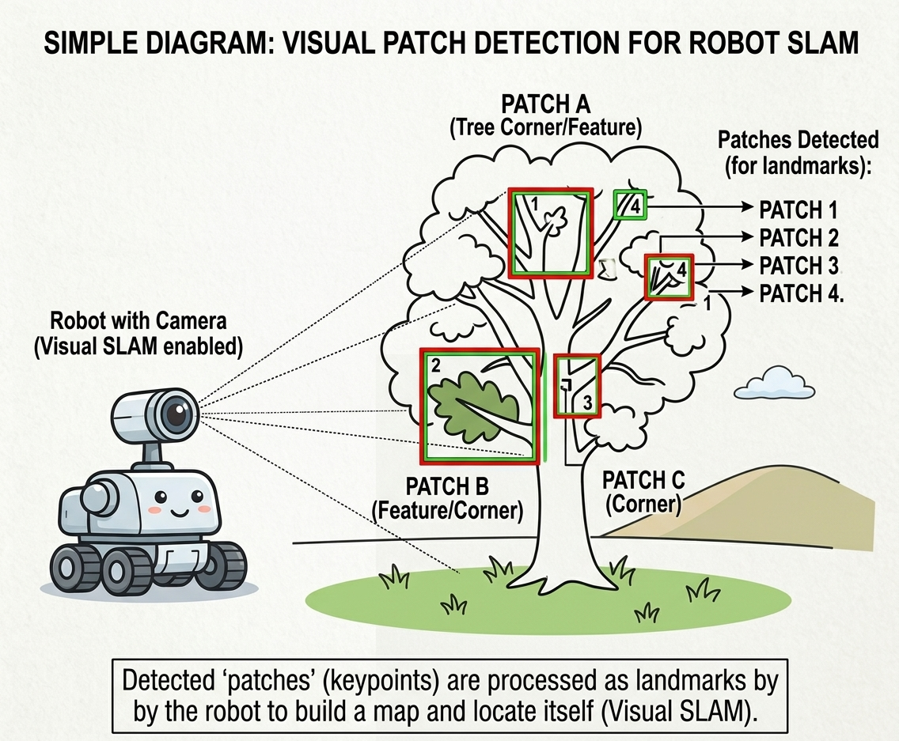

- [🎮 edge detection demo](edge-detection-demo.html)
 
- you detect landmarks or keypoints

- and start storing them in a database of landmarks

- When I detect a new landmark, you can compare it to your entry in the database

- _keyframes_

- detect changes (differences) and called it a new frame (_keyframe_ 🖼 )

- OpenCV has libraries for this

- _optical flow_: keeps tracks of corners between frames. `cv_optical_flow`

- you can find velocity _vx_ _vy_

- [🎮 demo of optical flow using opencv in browser](cv_optical_flow.html)

- 🤔❓what can you do with this?

- you can find x and y

- but you cannot get rotation

- motion model will be needed

- 🚙 cars like _Wyamo_ integrate cameras, radar (CANbus [Controller Area Network bus]) and other sensors to do `visual inertial odometry`

- you can then self-localise

- see flow diagram below (again)

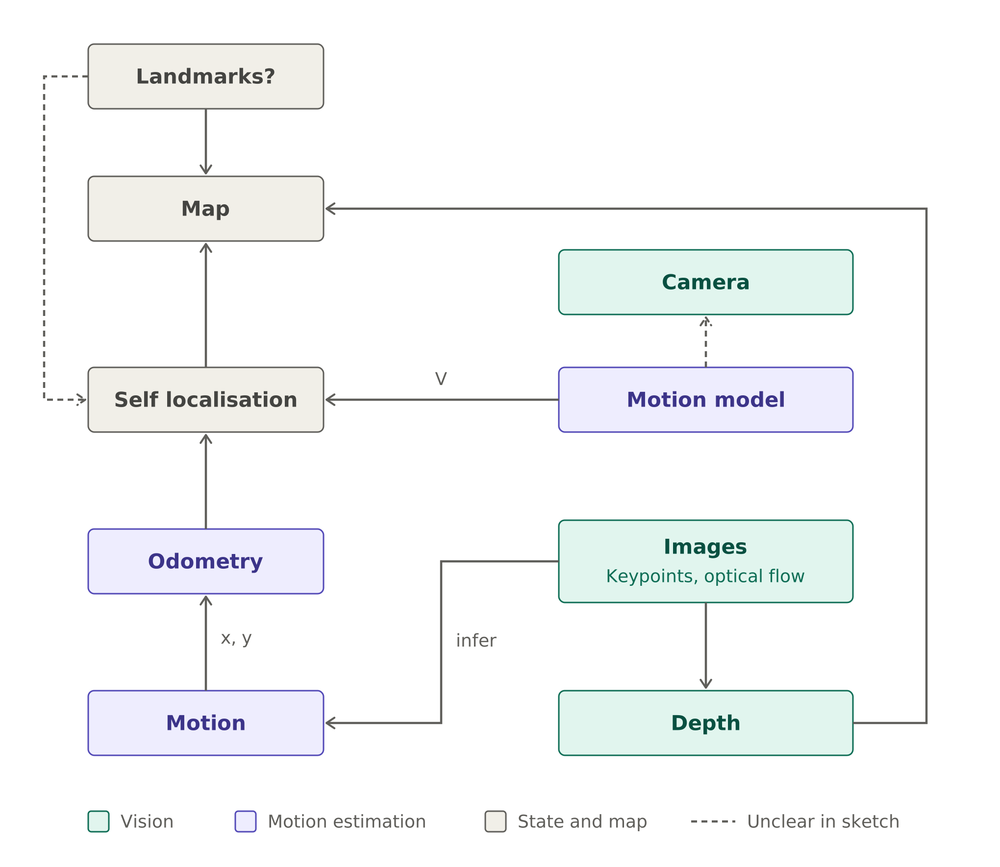

 
- `monocular SLAM` (one camera system)

- with binocular system, you can use disparity between two images to get depth of objects 

## Recap/Summary of VSLAM

- camera gives us images

- from those images infer motion

- from that infer depth

- from motion infer odometry

- use that for self-localisation

- use that to build a map

- use features to use as patches landmarks

- use that to build a map

- those same features/patches can be used for odometry (`optical flow`)

- getting intrinsic parameters of camera is important

- extrinsic parameters (rotation, translation)

- key frames (🖼 tracking difference between frames: if large difference then key frame and from that extract key features)

## Differences between visual odometry and visual SLAM

- [Differences between `visual odometry` and visual SLAM](visual_odometry_vs_slam_guide.md)

- basically a difference in how much memory

## Back to visual SLAM

- How to get depth?

- _Intellisense_ has accelerometers and can infer depth

- IR camera

- An IR time-of-flight (ToF) camera emits infrared light and measures how long it takes for the light to travel to an object and back to the sensor. Since light travels at a known speed, the measured travel time gives the distance:

- `Depth = (speed of light × round-trip time) / 2`

- The camera therefore produces a depth map, where each pixel contains the distance to the corresponding point in the scene. In visual SLAM, this depth information helps the robot estimate 3D structure and its own position without relying solely on stereo correspondence or monocular scale estimation.

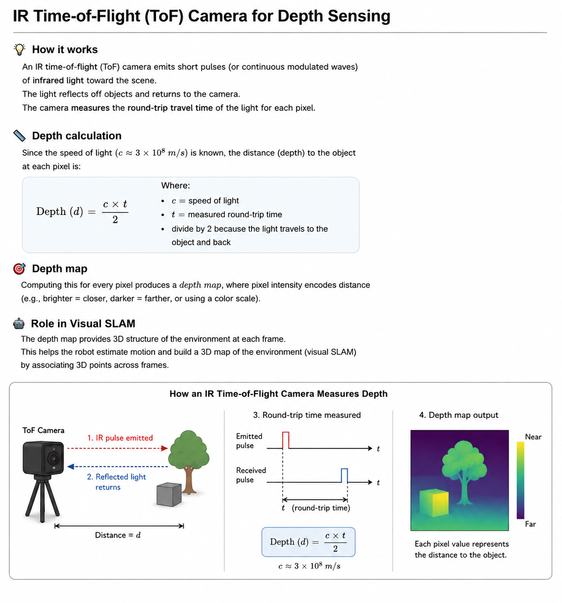

- these are called _RGBD_ cameras (D for depth)

- IMU has accelerometer and gyroscope

- by combining them you can have visual inertial SLAM or visual inertial odometry

- distance between two cameras in binocular must be known

## MonoSLAM

- monocular SLAM

- if you have two cameras, use differences between image (`disparity map`)

- use this to infer _depth_

- Intel Realsense cameras have two cameras and a time of flight IR sensor to infer depth

- distance between two cameras must be known

- opencv

- initialization step known target

- smooth motion model

- feature tracking

- direct method use all information from frame to infer which direction camera is moving and infer `odometry`

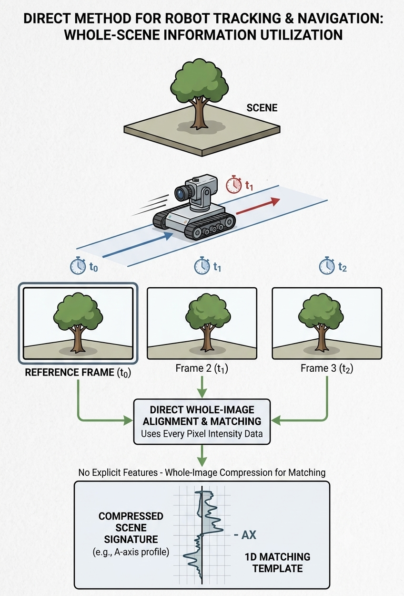

- feature based: use feature like corner

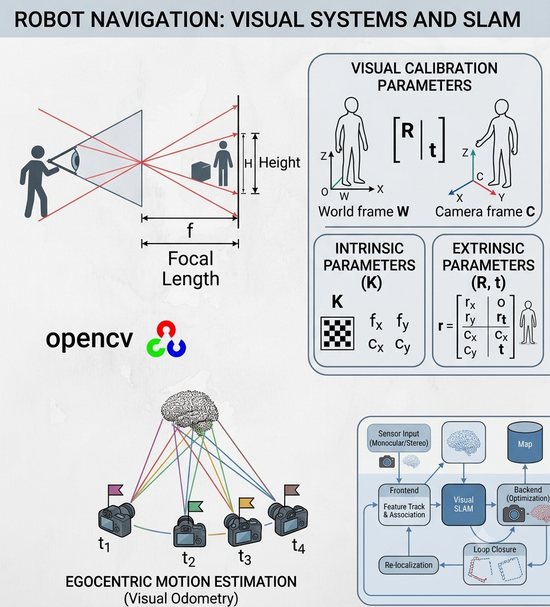
 
- there are different kinds of SLAM that uses direct or indirect method

- Recap: visual SLAM builds a map using visual features and self-localizes in the map

- by moving the camera, we can detect the depth of objects

- you can then project things into the environment (_Pokemon_)

- [🎥 video of augmented reality and tracking](https://www.youtube.com/watch?v=Y9HMn6bd-v8)

- parallel tracking and mapping (PTAM)
- tracking key frames
- then project virtual objects into that environment
- if features removed, then system will get confused

- with two cameras infer depth (if distance between cameras known)
- visual odometry: direct vs. indirect

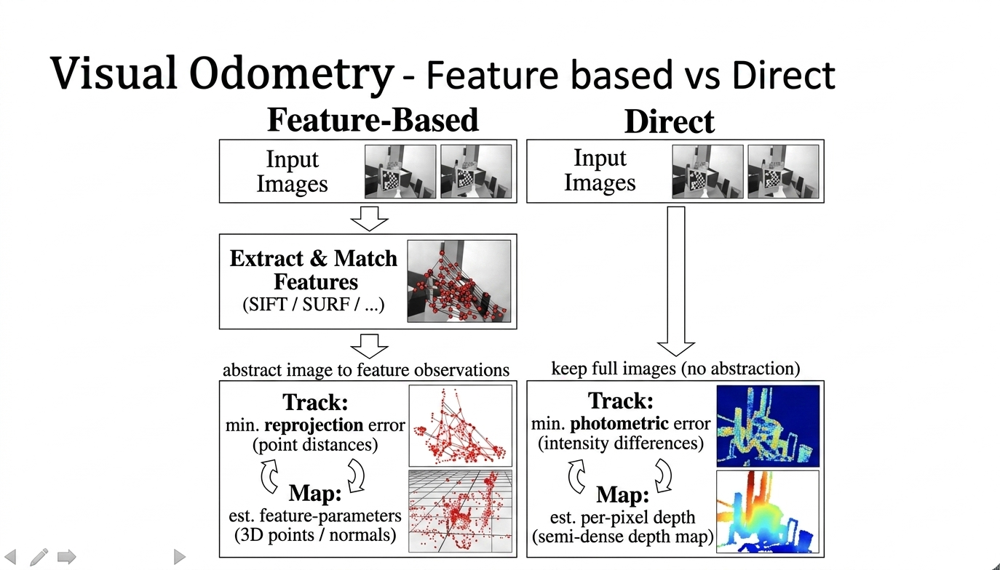

- monocular SLAM. need key frame

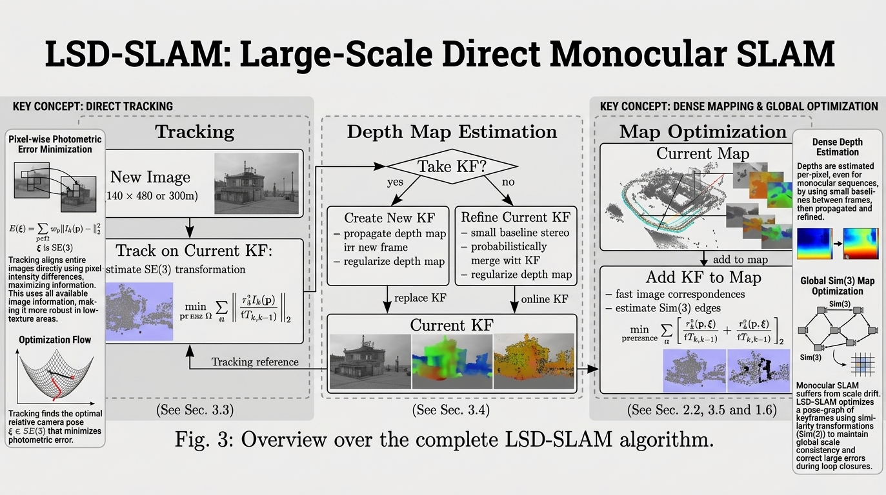

- 🤔 ❓what problems can occur if you use odometry to build a map?

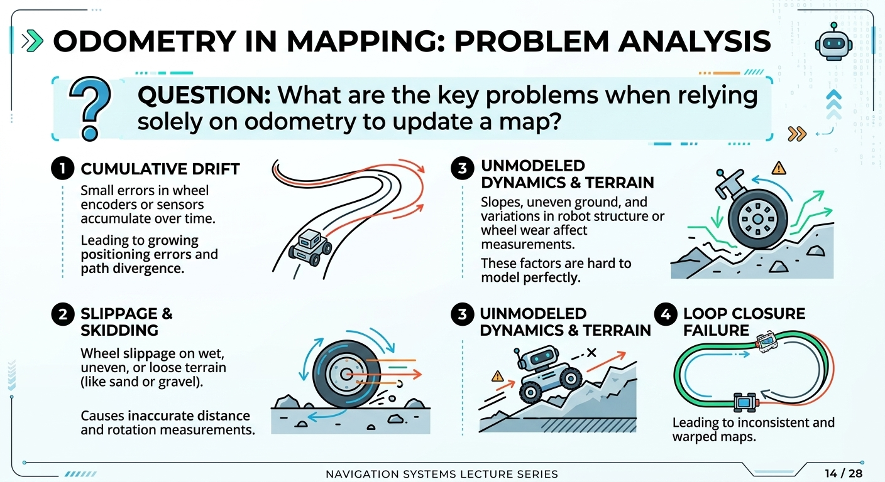

- use landmarks

- you track a particular feature and you know that it is (0,0) origin

- refine the estimate and correct drift

- 🤔 ❓what challenges can come up when you are building semi-autonomous robots doing navigation on [Mars](https://www.youtube.com/watch?v=n7uYOmTZJ6A)?

- filter based and motion model (Kalman filter)

- get better estimate of odometry

### Real time appearance based mapping (RTAB-MAP)

- STM short term memory

- occupancy map in 3D

- RTAB-Map (Real-Time Appearance-Based Mapping) is a RGB-D SLAM approach based on a global loop closure detector with real-time constraints. 

- RTAB-Map combines visual features and depth information for visual SLAM. This package can be used to generate 3D point clouds of the environment and/or to create a 2D occupancy grid map for navigation.

- Specifically:
When using RGB-D cameras, it uses both color images and depth data to estimate motion and build maps.

- When running in stereo or monocular mode, it extracts visual features (commonly SURF, SIFT, ORB, or BRISK) to perform visual odometry and loop closure detection.

- In monocular and stereo visual SLAM, SIFT, SURF, ORB, and BRISK are computer vision algorithms used to extract and describe visual features (distinctive points such as corners, edges, or textured blobs) from image frames.

- It builds and maintains a graph-based map, where nodes represent keyframes and edges represent estimated transformations between them.

- The loop closure detection relies on appearance-based matching — comparing visual features across frames to detect when the robot revisits a known area.

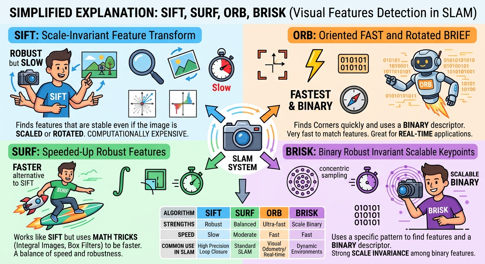

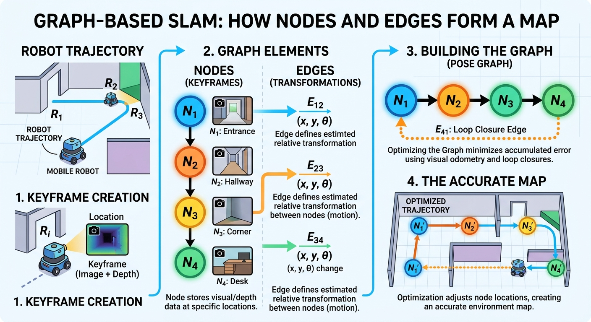

### Backend

- optimisation based approach

- filter based approach (Kalman filters, extended Kalman filters)

- filter based vs optimisation based (see figure below)

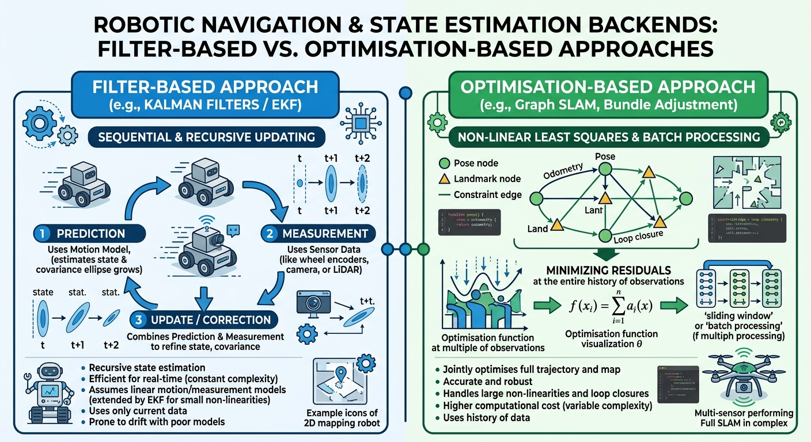

- lecture material on filters vs. optimisation [here](assets/filters_vs_optimisation.pdf)

### Motion models

- odometry sensors to estimate camera motion

- constant velocity model: assumes that the camera moves at constant velocity

- loop closure detection

- backend and frontend and map

### 🤔 ❓Case studies

Discuss the following with your peers (class discussion)

- autonomous SLAM
- indoor
- city navigation
- mining

## Practical (notes) courtesy Pedo Ribeiro

- Stella-VSLAM uses feature-based visual odometry and mapping.

- Specifically:
It extracts ORB features (Oriented FAST and Rotated BRIEF descriptors) from images.

- It matches these features between consecutive frames to estimate camera motion.

- It triangulates 3D points from matched features to build a map.

- Implication
Because of this:

- Feature-poor environments (plain walls, uniform lighting, reflective or dark surfaces) can cause Stella-VSLAM to lose tracking.
- Richly textured scenes (office spaces, outdoor environments, structured rooms) work best.

- If you are running it in Gazebo with the TurtleBot3, note that the default world (flat floor, grey walls) lacks texture — which is why the camera often “sees nothing useful.”

## Cleaning robots using SLAM in India

- [Jammu-based URC Robotics has unveiled X40, their autonomous floor-cleaning robot for commercial facilities. It uses LiDAR SLAM and ROS 2 for navigation](https://x.com/RuntimeBRT/status/2111002114264830319)

## Unmanned vessels India

- [Unmanned vessels doing autonomous 🧭 India](https://www.youtube.com/watch?v=MkkyJLP3e4w)
