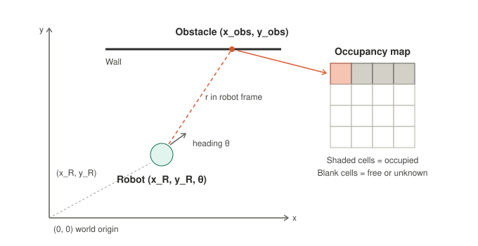
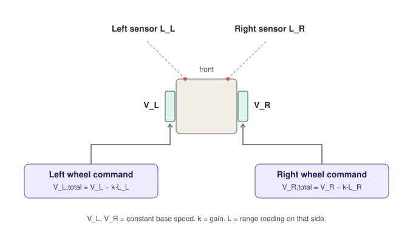

# Robot navigation and SLAM: from reactive control to mapping


## 1. Frames and pose



**World frame.** A fixed frame with its origin at $(0, 0)$, for example a corner of the room. The map lives in this frame.

**Robot pose.** The robot's position and heading in the world frame:

$$\mathbf{p} = (x_R,\; y_R,\; \theta)$$

where $\theta$ is the angle between the robot's forward direction and the world $x$-axis.

**Robot frame.** A frame attached to the robot, with its origin at the robot and its $x$-axis pointing forward. A range sensor reports obstacles in this frame, written $(x_{obs}^{R},\; y_{obs}^{R})$. The superscript $R$ means "expressed in the robot frame".

---

## 2. From robot frame to world frame

To put a measurement on the map we convert it to world coordinates. This is a rotation by $\theta$ followed by a translation by the robot's position:

$$
\begin{aligned}
x_{obs} &= x_R + x_{obs}^{R}\cos\theta - y_{obs}^{R}\sin\theta \\
y_{obs} &= y_R + x_{obs}^{R}\sin\theta + y_{obs}^{R}\cos\theta
\end{aligned}
$$

In matrix form:

$$
\begin{bmatrix} x_{obs} \\ y_{obs} \end{bmatrix}
=
\begin{bmatrix} x_R \\ y_R \end{bmatrix}
+
\begin{bmatrix} \cos\theta & -\sin\theta \\ \sin\theta & \cos\theta \end{bmatrix}
\begin{bmatrix} x_{obs}^{R} \\ y_{obs}^{R} \end{bmatrix}
$$

**Common student errors**

- Forgetting the rotation (this is only valid when $\theta = 0$).
- Mixing degrees and radians.
- Using the wrong sign convention for $\theta$ (counter-clockwise positive is standard).

**Sensor that returns range and bearing.** If the sensor gives a distance $r$ and a bearing $\phi$ relative to the robot's heading, first convert to the robot frame:

$$x_{obs}^{R} = r\cos\phi, \qquad y_{obs}^{R} = r\sin\phi$$

and then apply the transform above.

---

## 3. Occupancy maps

An **occupancy grid** divides the world into cells. Each cell stores whether it is occupied, free or unknown.

**Update procedure for one range measurement**

1. Convert the measurement to world coordinates $(x_{obs}, y_{obs})$ using Section 2.
2. Find the grid cell containing that point and mark it **occupied**.
3. Mark the cells along the ray from the robot to the obstacle as **free**, since the beam passed through them.
4. Leave cells beyond the obstacle **unknown**.

**Probabilistic version.** Real sensors are noisy, so each cell stores a probability or, more commonly, a log-odds value $\ell$ that is incremented on a hit and decremented on a miss:

$$\ell_{t}(c) = \ell_{t-1}(c) + \ell_{\text{sensor}}(c)$$

Repeated consistent readings push a cell firmly toward occupied or free, while occasional bad readings are averaged out.

---

## 4. Reactive control for a differential-drive robot



A **differential-drive** robot has two independently driven wheels. Let $V_L$ and $V_R$ be the left and right wheel speeds.

- Equal speeds: the robot drives straight.
- Right wheel faster than left: the robot turns left.
- Left wheel faster than right: the robot turns right.

**Constant base speed.** Start from a constant forward speed for each wheel, $V_L = V_R = V$. This gives constant linear velocity when no obstacles are sensed.

**Sensor-driven correction.** Each wheel's speed is reduced by its own side's sensor reading, scaled by a gain $k$:

$$
\begin{aligned}
V_L^{\text{total}} &= V_L - k\,L_L \\
V_R^{\text{total}} &= V_R - k\,L_R
\end{aligned}
$$

where $L_L$ and $L_R$ are the left and right sensor readings.

### What does $L$ mean? This decides the behaviour

| Reading $L$ | Obstacle close on the right | Wheel effect | Behaviour |
|---|---|---|---|
| **Distance** (small when close) | $L_R$ is small | Right wheel slowed *less* than left | Turns **left**, away from the obstacle |
| **Proximity** (large when close) | $L_R$ is large | Right wheel slowed *more* than left | Turns **right**, toward the obstacle |

For obstacle avoidance with the equations above, use a distance reading. With a proximity reading, flip the sign (add $k\,L$ instead of subtracting) or cross the wiring between sensors and wheels.

A side effect of the distance convention is that the robot drives slower in open space, because $L$ is large there. Many implementations clamp $L$ to a maximum range or subtract $k\,(L_{\max} - L)$ instead.

---

## 5. Braitenberg vehicles

The wiring above is an example of a [**Braitenberg vehicle**](https://en.wikipedia.org/wiki/Braitenberg_vehicle), from Valentino Braitenberg's 1984 book *Vehicles: Experiments in Synthetic Psychology*. These are thought experiments in which sensors are connected directly to motors, with no map, memory or planning. Different wiring produces behaviour an observer would describe in psychological terms.

| Vehicle | Wiring | Behaviour |
|---|---|---|
| 2a "fear" | Same-side sensor excites wheel | Turns away from the stimulus and speeds off |
| 2b "aggression" | Opposite-side sensor excites wheel | Turns toward the stimulus and charges at it |
| 3a "love" | Same-side sensor inhibits wheel | Approaches the stimulus, slows and stops facing it |
| 3b "explorer" | Opposite-side sensor inhibits wheel | Turns away and slows near the stimulus |

**Teaching point.** Useful, apparently purposeful behaviour needs almost no computation. This is also the clearest way to show what reactive control cannot do: it has no memory, no goals and no model of the world.

---

## 6. Why reactive control is not enough: motivating SLAM

Reactive controllers fail in situations such as:

- **Local traps**: corners and dead ends where avoiding one wall points the robot at another.
- **No global goal**: the robot cannot plan a route to a specified location.
- **No memory**: it re-discovers the same obstacle every time.

The fix is to build and use a map. But Section 2 shows that a correct map needs a correct pose, and the robot's pose estimate drifts because wheel odometry accumulates error. To correct the pose, the robot needs the map. This is the **SLAM** problem: *Simultaneous Localisation And Mapping*.

$$
\underbrace{\text{map}}_{\text{needs pose}} \;\;\longleftrightarrow\;\; \underbrace{\text{pose}}_{\text{needs map}}
$$

**Typical SLAM loop**

1. **Predict** the new pose from odometry (wheel encoders, IMU).
2. **Sense** the environment with range sensors or a camera.
3. **Match** the new scan against the current map to correct the pose.
4. **Update** the map using the corrected pose (Section 3).
5. **Close loops**: when the robot returns to a known place, correct accumulated drift across the whole trajectory.

Common families include filter-based SLAM (EKF, particle filters), graph-based SLAM (pose-graph optimisation) and visual SLAM.

---

## 7. Worked code example

A minimal Python sketch for the transform, occupancy update and reactive controller.

```python
import math

def robot_to_world(x_r, y_r, theta, x_obs_R, y_obs_R):
    """Convert an obstacle point from robot frame to world frame."""
    c, s = math.cos(theta), math.sin(theta)
    x_obs = x_r + x_obs_R * c - y_obs_R * s
    y_obs = y_r + x_obs_R * s + y_obs_R * c
    return x_obs, y_obs

def mark_occupied(grid, x_obs, y_obs, cell_size):
    """Mark the grid cell containing (x_obs, y_obs) as occupied (1)."""
    col = int(x_obs // cell_size)
    row = int(y_obs // cell_size)
    if 0 <= row < len(grid) and 0 <= col < len(grid[0]):
        grid[row][col] = 1

def wheel_speeds(v_base, k, l_left, l_right):
    """Braitenberg-style control; l_* are distance readings."""
    v_left = v_base - k * l_left
    v_right = v_base - k * l_right
    return v_left, v_right

# Example: robot at (2, 2) facing 45 degrees, obstacle 3 m straight ahead
x, y = robot_to_world(2.0, 2.0, math.radians(45), 3.0, 0.0)
print(round(x, 2), round(y, 2))   # 4.12 4.12
```

---

## 8. Discussion questions and exercises

1. A robot at $(1, 1)$ with $\theta = 90^\circ$ measures an obstacle at $(2, 0)$ in its own frame. Where is the obstacle in the world frame? *(Answer: $(1, 3)$.)*
2. What happens to the map if the robot's heading estimate is off by $5^\circ$ and the obstacle is $10\,\text{m}$ away? *(Roughly $0.87\,\text{m}$ sideways error.)*
3. Using the controller in Section 4, what happens if $L_L = L_R$? Is that enough to guarantee the robot avoids a wall head-on?
4. Which Braitenberg wiring would you choose for a robot that should follow a light source, and which for one that should avoid it?
5. Why can a Braitenberg vehicle not solve a maze, and what minimal extra ingredient would help?

---

## 9. Summary

| Concept | Key idea |
|---|---|
| Pose | $(x_R, y_R, \theta)$ in the world frame |
| Frame transform | Rotate by $\theta$, then translate by $(x_R, y_R)$ |
| Occupancy grid | World cut into cells, updated from each measurement |
| Reactive control | $V^{\text{total}} = V - k\,L$ per side; sign depends on what $L$ measures |
| Braitenberg vehicles | Sensor-to-motor wiring alone gives lifelike behaviour |
| SLAM | Pose and map must be estimated together |

## Further reading

- V. Braitenberg, *Vehicles: Experiments in Synthetic Psychology*, MIT Press, 1984.
- S. Thrun, W. Burgard and D. Fox, *Probabilistic Robotics*, MIT Press, 2005.
- R. Siegwart, I. Nourbakhsh and D. Scaramuzza, *Introduction to Autonomous Mobile Robots*, MIT Press, 2nd ed., 2011.

<!--
Author checklist before publishing (not rendered):
- Confirm the boxed pose equation in the original handwritten notes matches Section 2 (the sketch may assume theta = 0).
- Confirm whether the original used more than two range sensors.
- Confirm whether L in the original denotes distance or proximity, and adjust Section 4 to match.
-->
