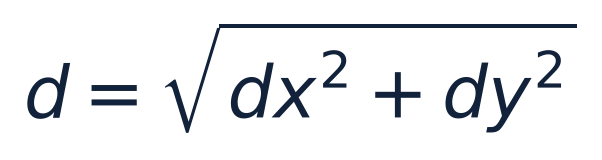
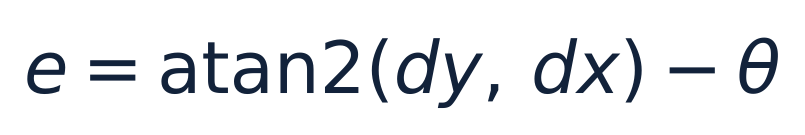
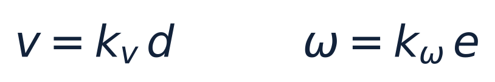
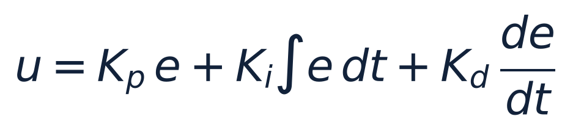
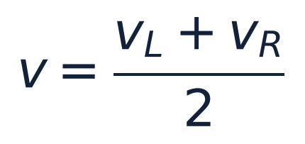
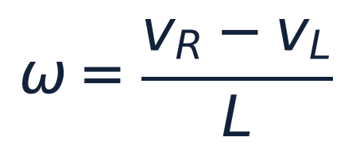
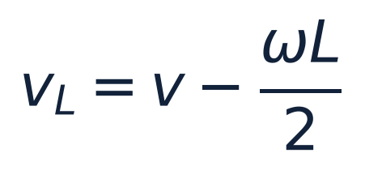
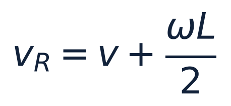

# From waypoints to wheel velocities

A path planner only says *where* to go: a list of points (*x*₁, *y*₁), (*x*₂, *y*₂), and so on. The robot controller has to turn each point into two numbers the motors understand: a left wheel speed and a right wheel speed.

Each control tick, the controller does three things for the current target point.

## 1. Measure the error

From the robot's pose (*x*, *y*, *θ*) and the target, compute the offsets *dx* and *dy*, then the distance to the target:

and the heading error, which is the angle the robot must turn to face the target:

## 2. Choose a body motion

Pick a forward speed *v* and a turn rate *ω*. The simplest choice is proportional control: go faster when far away, turn harder when pointing the wrong way.

Here *k*v and *k*ω are gains you choose. This is where a PID controller fits in: it replaces the simple turn rule with

and *u* is used as the turn command.

## 3. Split the body motion into two wheel speeds

A differential-drive robot moves forward at the **average** of its two wheel speeds:

and it turns at the **difference** of the wheel speeds divided by *L*, the distance between the wheels:

These are two equations with two unknowns. Solving them for the wheel speeds gives the conversion the controller actually uses:

## Summary

The planner's coordinates become (*d*, *e*), then (*v*, *ω*), then (*v*L, *v*R).

- Equal wheel speeds (*ω* = 0): the robot drives in a straight line.
- Right wheel faster than left (*ω* > 0): the robot turns left.
- Equal and opposite wheel speeds (*v* = 0): the robot spins on the spot.
- A larger wheel spacing *L* needs a larger speed difference to produce the same turn rate.

## Worked example

Wheel spacing *L* = 40 cm. The controller has chosen *v* = 60 cm/s and *ω* = 1 rad/s.

- *v*L = 60 − (1 × 40) / 2 = 40 cm/s
- *v*R = 60 + (1 × 40) / 2 = 80 cm/s

Check: the average is (40 + 80) / 2 = 60 cm/s, and the turn rate is (80 − 40) / 40 = 1 rad/s.
